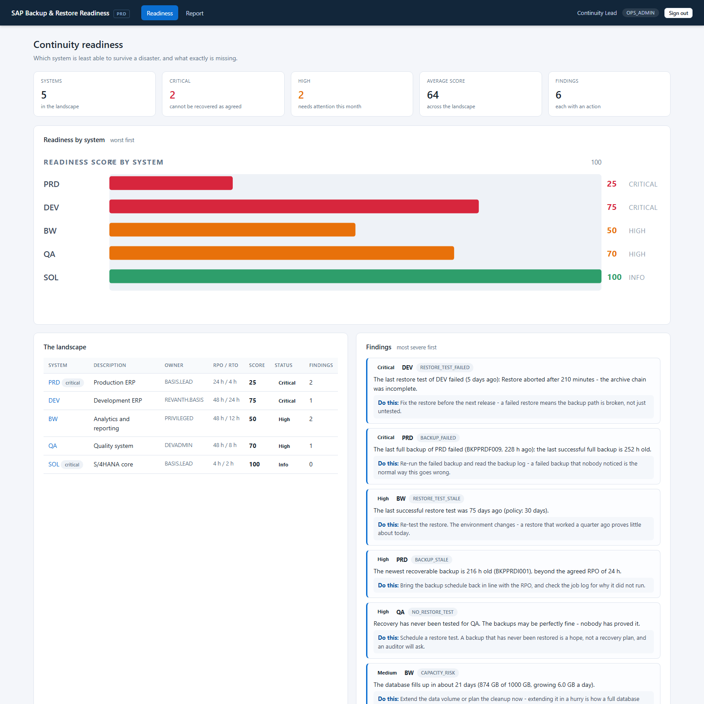
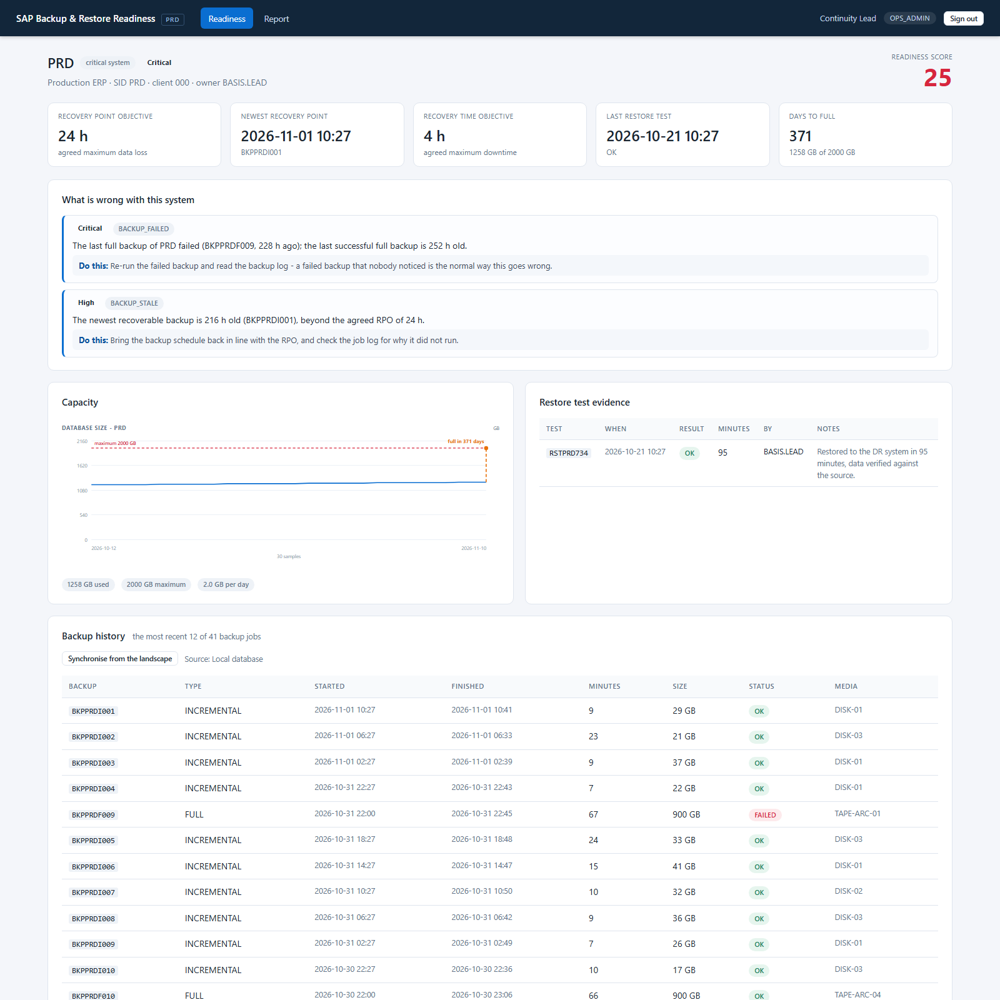
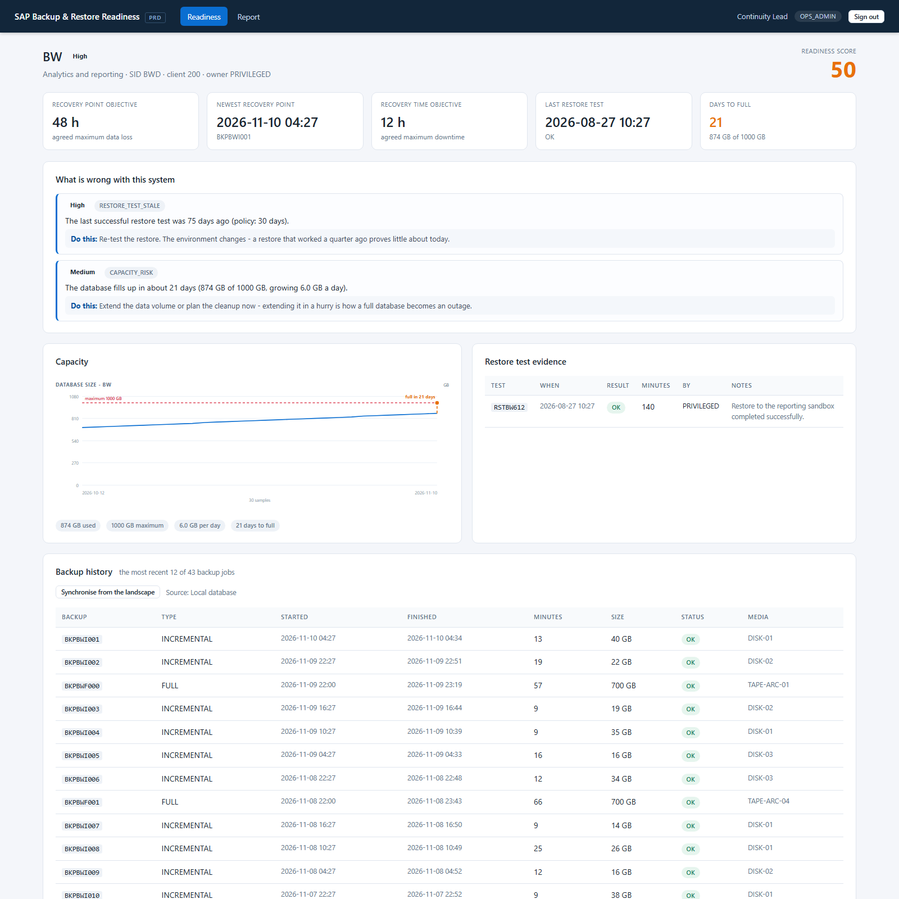
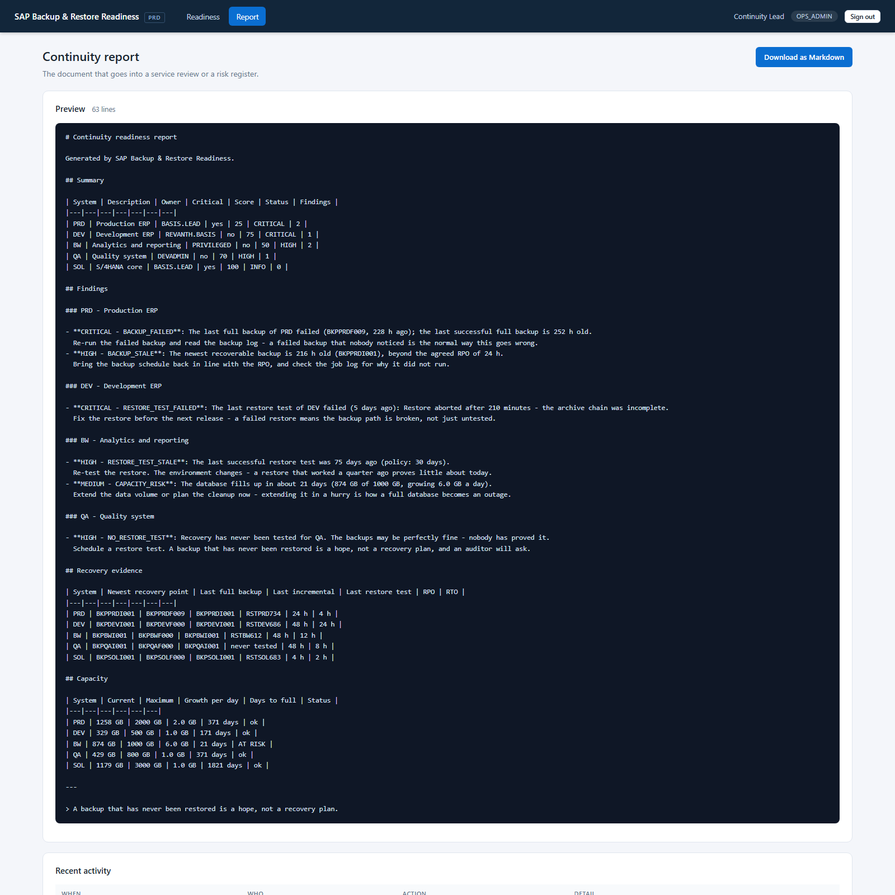
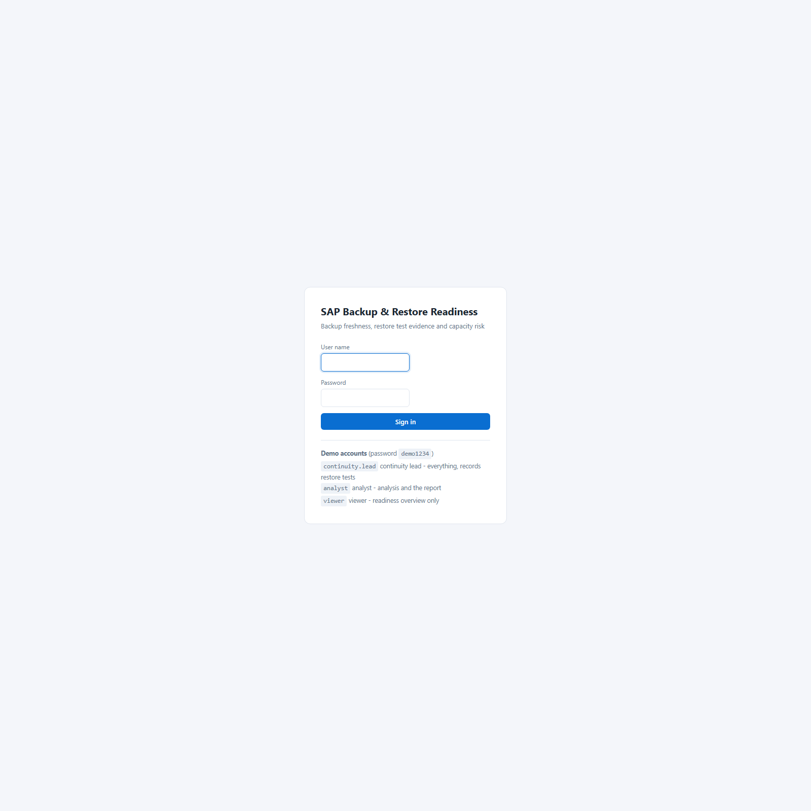

<div align="center">

# SAP Backup &amp; Restore Readiness

**Continuity operations for SAP landscapes — backup freshness against the RPO, restore test evidence, capacity forecasting and a per-system readiness score**


</div>

---

## The problem

*"We have backups."*

Every landscape says that. The question that is never asked is whether the
backups are **current enough to meet the recovery point objective the customer
signed**, and whether anybody has **ever restored one**.

A backup job that fails silently looks exactly like a backup job that is
running. A backup that has never been restored is a hope, not a recovery plan.
And the database that grows 6 GB a day fills up on a Tuesday, in the middle of
a release weekend, whichever day that happens to be.

This portal turns continuity into a number with the evidence behind it:

1. **Are the backups current?** — measured against the agreed RPO, and against
   the *newest recoverable backup*, not against "did the job fire".
2. **Has recovery been proven?** — a restore test, and how old it is. The
   question a backup dashboard never asks and the auditor always does.
3. **Is there room?** — a linear forecast of the day the database runs out.

The result is a per-system readiness score **and the findings behind it**. The
score is only there so that thirty systems can be sorted.

---

## Screenshots

### The readiness overview — which system is least able to survive a disaster

> PRD scores 25. Its last full backup **failed nine days ago** and nothing has
> run since. DEV scores 75 and is still *critical*: its backups are perfect and
> its last restore test failed.



### PRD — a broken backup chain, with the action attached to every finding



### BW — the restore test is 75 days old and the database fills up in 21 days



### The continuity report — the document that goes into a service review



### Sign in



---

## Run it

### Requirements

* **Java 8 or newer** (the code targets Java 8 and `javax.servlet`, so it can
  be deployed on the NetWeaver 7.5 Java stack)
* **Maven 3.6+**
* Nothing else. No SAP system, no SAP licence, no database server.

```bash
git clone https://github.com/Revanth2716/sap-backup-readiness.git
cd sap-backup-readiness
mvn clean package
java -jar target/sap-backup-readiness.jar
```

Open <http://localhost:8084> and sign in:

| User | Role | Sees |
|---|---|---|
| `continuity.lead` | OPS_ADMIN | Everything, including recording restore tests and synchronising from the landscape |
| `analyst` | ANALYST | The analysis and the report |
| `viewer` | VIEWER | The readiness overview only |

Password: `demo1234` (configurable; switch the accounts off with
`readiness.seed-demo-users=false`).

### Run the tests

```bash
mvn test
```

```
Tests run: 53, Failures: 0, Errors: 0, Skipped: 0
BUILD SUCCESS
```

---

## The landscape it ships with

The seeded data is not random noise — every number exists because it
demonstrates one specific finding:

| System | Score | Status | The story |
|---|---|---|---|
| **PRD** | 25 | CRITICAL | The backup chain **stopped nine days ago**. The last full backup *failed*, the newest recovery point is 216 h old against a 24 h RPO. |
| **DEV** | 75 | CRITICAL | The backups are perfect and current — but the **last restore test failed**. The score band says "medium"; the severity says *critical*, and the severity wins. |
| **BW** | 50 | HIGH | The restore test is **75 days old**, and the database reaches its 1000 GB limit in **21 days** at 6 GB a day. |
| **QA** | 70 | HIGH | Everything is current and nothing is wrong — recovery has **never been tested**. |
| **SOL** | 100 | INFO | Healthy. A restore test eight days ago proves it. |

---

## Architecture

```
                    ┌────────────────────────────────────────┐
                    │        web layer (Spring MVC)          │
                    │  Readiness · System detail · Report ·   │
                    │  REST API · session auth + role gate    │
                    └───────────────────┬────────────────────┘
                                        │
                    ┌───────────────────▼────────────────────┐
                    │            service layer               │
                    │  ReadinessService                       │
                    │    · backup freshness against the RPO  │
                    │    · restore test evidence             │
                    │    · severity = the worst finding      │
                    │  CapacityService  · linear forecast    │
                    │  BackupSyncService · additive sync      │
                    │  AuditService                          │
                    └───────────────────┬────────────────────┘
                                        │
                    ┌───────────────────▼────────────────────┐
                    │       repository layer (JdbcTemplate)   │
                    │  SYS_CONFIG · SYS_BACKUP ·              │
                    │  SYS_RESTORE_TEST · SYS_CAPACITY        │
                    └───────────────────┬────────────────────┘
                                        │
              ┌─────────────────────────┴─────────────────────────┐
              │                                                   │
   ┌──────────▼───────────┐                        ┌──────────────▼─────────────┐
   │  H2 (local, seeded)  │                        │  SAP HANA                  │
   │  the demo database   │                        │  live NetWeaver landscape  │
   └──────────────────────┘                        └────────────────────────────┘
```

Five decisions carry the project:

**1. The newest *recoverable* backup, not the newest backup job.**
A full backup that failed nine days ago is the most recent backup job and the
worst possible news. The readiness engine separates the newest *attempt* from
the newest *successful* backup, and measures the RPO against the latter — which
is the only thing that can actually be restored.

**2. A broken chain is reported once.**
Three overlapping findings for one broken backup job would make the report
longer, not clearer. The engine reports the most specific cause and suppresses
the rest — so "the backups stopped" is one finding with one action, not three.

**3. The severity is the worst finding, not the score band.**
DEV scores 75 out of 100. On a score band that is "medium". Its restore test
*failed*, so it is **critical**. If the severity were derived from the score, a
failed restore could hide behind a good average — which is exactly how it hides
in a real landscape.

**4. Every finding carries an action.**
"Your restore test is stale" is not something anybody can act on at 09:00. Each
finding states the fact, and then what to do about it: *"Re-test the restore.
The environment changes — a restore that worked a quarter ago proves little
about today."*

**5. The charts are drawn on the server.**
Plain SVG, no chart library, no CDN and no client-side JavaScript. A tool that
has to run inside a corporate landscape where outbound internet is blocked
cannot depend on a CDN — and an auditor has to be able to save the page and
still see the evidence.

---

## The SAP-side artifacts

The ABAP and the RFC client that a live NetWeaver system would talk to are
included. They are written against NetWeaver 7.5 semantics and are **ready to
compile**; they have not been executed on a live system, because none was
available when this was built (see [`docs/HONEST-STATUS.md`](docs/HONEST-STATUS.md)).

| File | Purpose |
|---|---|
| `abap/Z_BACKUP_STATUS.abap` | RFC-enabled function module reading the backup catalog from `M_BACKUP_CATALOG_FILES` |
| `abap/Z_BACKUP_TYPES.abap` | The DDIC structure (`ZRDY_BKP`) the module imports |
| `src/extra/java/.../RfcBackupStatusGateway.java` | JCo client that calls it over an RFC destination maintained in `SM59` |
| `src/main/java/.../BackupStatusGateway.java` | The interface that keeps RFC out of the rest of the code |

> **The one line that decides whether RFC works at all:** create the function
> module in `SE37` with **Remote-Enabled** ticked. Without it the call fails
> with *"function module not found / not remote enabled"* — and the error
> surfaces as an `SM58` entry on the **calling** system, not as a dump on the
> callee. That asymmetry is what makes it confusing the first time.

> **What the function module deliberately does not do:** report whether a restore
> has ever been tested. The database has no idea. That evidence is a manual
> record, and it lives in the portal — which is precisely the gap the readiness
> score exists to close.

---

## Moving to a live SAP system

```bash
mvn -Pwith-jco clean package     # adds the JCo RFC adapter
mvn -Phana   clean package       # adds the SAP HANA JDBC driver
```

Then set `readiness.gateway: jco` and copy `jco.properties.example` to
`jco.properties`. The SQL is portable ANSI, so pointing the datasource at HANA
is a configuration change, not a code change. Full detail in
[`docs/DEPLOYMENT.md`](docs/DEPLOYMENT.md).

---

## Testing

53 tests across five classes:

| Test class | What it locks in |
|---|---|
| `ReadinessServiceTest` | Each readiness rule on its own — a failed backup, a breached RPO, a failed restore test, a stale one, a missing one, a capacity risk — and the two that matter most: **the severity is the worst finding, not the score band**, and **a broken chain is reported once** |
| `ContinuityLandscapeTest` | The story the seeded landscape has to tell, system by system, and that the counts add up |
| `BackupSyncServiceTest` | The sync is **additive** — running it twice changes nothing, because it is meant to run from a scheduler |
| `ApiControllerTest` | The REST API, that it is authenticated, that the health check is open, and that it never leaks a stack trace |
| `PageRenderTest` | **Every screen renders** — a template can compile and the service layer can be green while one page still returns HTTP 500 |

Three real bugs were caught by these tests while the project was being built:

* a **backup scheduled in the future**. The "nightly" backup was anchored to
  22:00 of the current day, so before 22:00 the newest backup had not happened
  yet — and a backup that has not happened yet is indistinguishable from a
  stale one. The anchor is now the most recent 22:00 that is already in the
  past.
* the **incremental history was generated twice over**, producing backups with
  identical timestamps under different identifiers. The generator now walks one
  timeline backwards from a single anchor.
* the markdown endpoint returned **HTTP 500 instead of 401** for an anonymous
  caller, because the `produces` attribute forced the JSON error body through
  a markdown converter. The content type is now set on the response.

---

## Resume content

Copy-paste blocks are in [`docs/RESUME.md`](docs/RESUME.md). The short form:

> **SAP Backup & Restore Readiness** — continuity operations for SAP landscapes
> *Java 8 · Spring Boot 2.7 · JdbcTemplate · SAP HANA · Thymeleaf · ABAP RFC · SAP Java Connector*
>
> - Built a **continuity readiness portal for SAP landscapes** that measures backup freshness against the **recovery point objective** (separating the newest *attempt* from the newest *recoverable* backup), scores **restore test evidence** as a first-class finding, forecasts **database capacity exhaustion**, and produces a per-system readiness score with a recommended action behind every finding.
> - Designed the scoring so that **a broken backup chain is reported once** and so that the **severity is the worst finding rather than the score band** — a failed restore test stays critical even when the average score is healthy.
> - Shipped the SAP-side artifacts (**RFC-enabled ABAP function module** reading `M_BACKUP_CATALOG_FILES`, **SAP Java Connector client** behind an optional Maven profile) and a **portable ANSI SQL** layer that runs unchanged on local H2 and SAP HANA, with **53 automated tests**.

---

## Honest status

| | |
|---|---|
| **Works and is tested today** | the whole application: 53 tests green, the JAR builds, every screen is rendered from the running app |
| **Written but not compiled against SAP** | the ABAP function module, the DDIC types, the JCo adapter — no NetWeaver system and no access to SAP's Maven repository |
| **Modelled, not measured** | the backup catalog, the restore test history and the capacity history are a seeded synthetic dataset, not a customer's landscape |
| **Known limitation** | the capacity forecast is a linear trend over the observed window, and the restore test history is a manual record — there is no automated proof that a restore still works |

Full detail, and the step that closes each gap, in
[`docs/HONEST-STATUS.md`](docs/HONEST-STATUS.md).

---

## Documentation

| Document | Read it when |
|---|---|
| [`ARCHITECTURE.md`](docs/ARCHITECTURE.md) | You want to know why it is built this way |
| [`DEPLOYMENT.md`](docs/DEPLOYMENT.md) | You are moving it to a real SAP landscape |
| [`TROUBLESHOOTING.md`](docs/TROUBLESHOOTING.md) | A finding looks wrong, or an RFC call fails |
| [`RESUME.md`](docs/RESUME.md) | You are putting this on a CV |
| [`INTERVIEW-QA.md`](docs/INTERVIEW-QA.md) | You are preparing to be asked about it |
| [`HONEST-STATUS.md`](docs/HONEST-STATUS.md) | You need to know exactly what to claim |
| [`LEARNING-LOG.md`](docs/LEARNING-LOG.md) | You want to see the thinking behind the code |

---

## Roadmap

- [ ] Compile and run the ABAP and JCo artifacts against NetWeaver 7.5
- [ ] Read the backup catalog from Oracle and Sybase as well as HANA
- [ ] Chain the restore test to the backup it used, so "this restore proves
      *that* backup" is a fact and not an assumption
- [ ] Keep a history of restore tests, so the trend "three tests, all failed
      since March" is visible
- [ ] Schedule the sync and mail the digest to the application team
- [ ] Replace the linear capacity forecast with a seasonal one, and add the
      log volume to the forecast — it is often what fills up first

---

## License

MIT — see [LICENSE](LICENSE).

This is a self-initiated portfolio project. SAP, NetWeaver, ABAP, SAP HANA and
the table and transaction codes referenced here are trademarks of SAP SE and
are used for technical reference and educational purposes.
